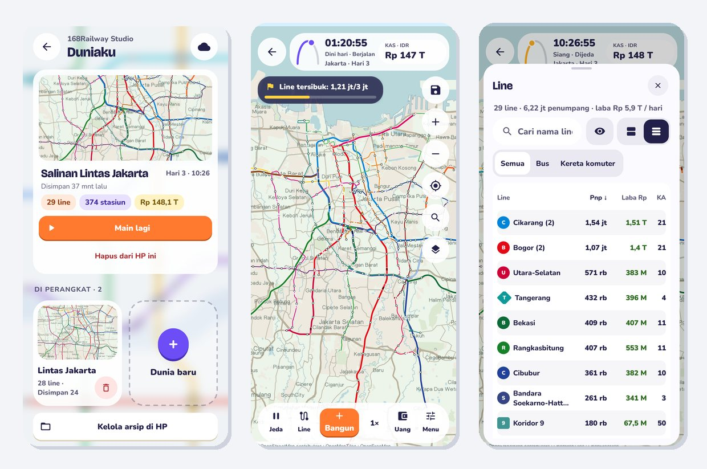
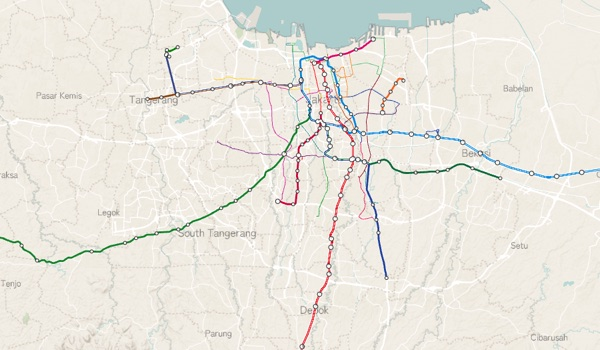
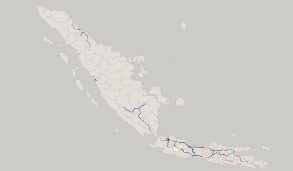
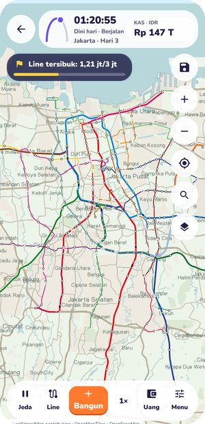
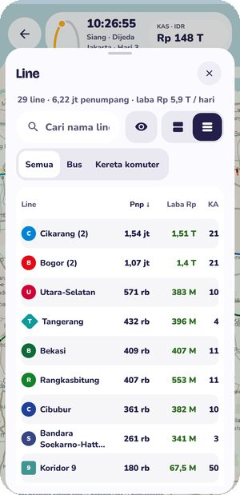
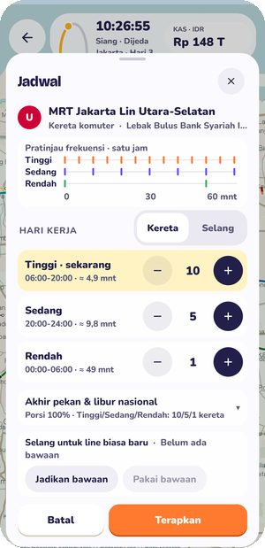
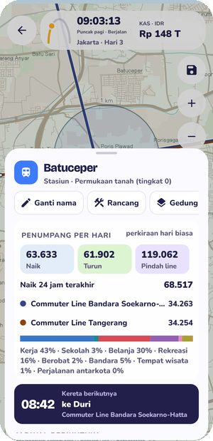
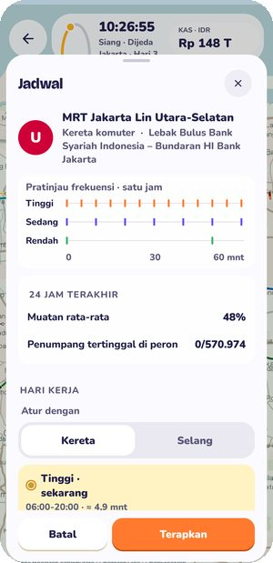
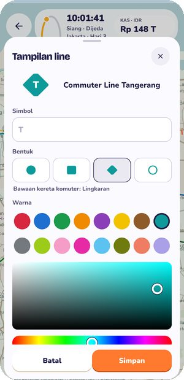
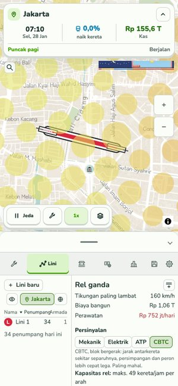

# 168Railway World

<p align="center">
  
</p>

<p align="center">
  <b>Bangun jaringan kereta di peta dunia nyata. Atur line, jadwal, dan tarif, lalu lihat siapa yang naik keretamu.</b><br>
  Main di browser: <a href="https://168railway.com/studio/">168railway.com/studio</a> · di HP: aplikasi <b>168Railway</b> (Android, menu World)
</p>

---

**English:** 168Railway World is a railway building game on a real map. You lay track and stations, run lines and
timetables, and a demand model decides who rides your trains and who drives instead. It is a fork of
[circularsquare/trainsworld](https://github.com/circularsquare/trainsworld), with Indonesian templates (KRL, MRT, LRT,
TransJakarta, GAPEKA 2026 intercity lines), 168Railway accounts, and a native Android client that runs the same Rust
simulation as the web. Source under AGPL-3.0, like upstream.

## Apa ini

- **Peta dunia nyata.** Tarik rel, taruh stasiun, dan bangun di atas jalan, sungai, dan kota sungguhan
  (OpenStreetMap). Rel bisa di permukaan, layang, atau bawah tanah; tunggal, ganda, atau empat jalur.
- **Penumpang yang dihitung, bukan dikarang.** Model permintaan membaca sebaran penduduk, tempat kerja, sekolah,
  belanja, dan wisata, lalu memutuskan rute tiap perjalanan: naik keretamu, ganti line, atau tetap naik mobil.
- **Operasi yang terasa.** Jadwal per periode (pagi, siang, malam, akhir pekan), kapasitas rel dan peron, kereta
  yang tertahan di persimpangan, persinyalan dari mekanik sampai CBTC, tarif, iklan, parkir, dan pinjaman.
- **Mulai dari nol atau dari jaringan nyata.** Tujuh jaringan contoh siap main, antara lain Red Line + Brown Line +
  TransJakarta, KRL Jabodetabek, Jakarta 2019, Jakarta lengkap, dan Seluruh Indonesia dari GAPEKA 2026.

<table>
  <tr>
    <td align="center"><br><sub>Jaringan contoh: Jakarta lengkap</sub></td>
    <td align="center"><br><sub>Seluruh Indonesia (GAPEKA 2026)</sub></td>
  </tr>
</table>

## Di Android

Aplikasi 168Railway punya World native: peta, kereta, dan semua panel digambar langsung di Kotlin, tanpa WebView.
Mesin simulasinya crate Rust yang sama dengan versi web (lewat JNI), jadi angka penumpang dan uang di HP sama
dengan di browser, dan dunia yang disimpan bisa dibuka di keduanya.

<table>
  <tr>
    <td align="center"><br><sub>Peta & kereta berjalan</sub></td>
    <td align="center"><br><sub>Daftar line: penumpang, laba, armada</sub></td>
    <td align="center"><br><sub>Jadwal per periode & muatan</sub></td>
  </tr>
  <tr>
    <td align="center"><br><sub>Stasiun: naik, turun, pindah line</sub></td>
    <td align="center"><br><sub>Okupansi 24 jam terakhir</sub></td>
    <td align="center"><br><sub>Warna, simbol & bentuk line</sub></td>
  </tr>
</table>

## Di web

<table>
  <tr>
    <td></td>
    <td>
      Versi web adalah game lengkapnya: halaman TypeScript (Preact + MapLibre) dengan simulasi dan model permintaan
      Rust yang dikompilasi ke WebAssembly. Di 168railway.com/studio kamu masuk dengan akun 168Railway, dunia
      disimpan ke akun, dan bisa dilanjutkan dari perangkat lain.<br><br>
      Contoh di samping: rel dipasang <b>CBTC</b>, kapasitasnya naik jadi 49 kereta/jam per arah.
    </td>
  </tr>
</table>

## Cara kerjanya

```
trainworld/
├── sim/             Rust: jaringan rel, jadwal, kapasitas, persinyalan, permintaan, uang, format save
├── app/             Web: TypeScript, Preact, MapLibre; sim dikompilasi ke WASM (src/wasm/)
├── native-android/  Android: Kotlin (android-lib/) + lapisan JNI Rust (src/) di atas crate sim
├── pipeline/        Python: membangun data kota (penduduk, jalan, rel nyata, medan)
├── checks/          Uji browser dan Node
└── docs/            Aturan permainan per bidang; docs/code-map.md menunjuk tiap modul
```

Satu mesin untuk dua klien: perubahan aturan di `trainworld/sim/` berlaku di web (setelah `npm run wasm`) dan di
Android (setelah build `native-android`). Save memakai format TWG1 yang sama.

## Menjalankan web secara lokal

Butuh Node 22+, Rust stable dengan target `wasm32-unknown-unknown`, dan wasm-pack 0.15.

```
rustup target add wasm32-unknown-unknown
cargo install wasm-pack
cd trainworld/app
npm install
npm run wasm
npm run dev
```

Buka alamat yang dicetak Vite (http://localhost:5173/). `npm run wasm` makan beberapa menit pertama kali; jalankan
lagi setiap kali `trainworld/sim/` berubah. `npm run check` memeriksa tipe.

## Membangun World Android

`trainworld/native-android/` adalah library Android (AAR) berisi `libworld_native.so` dan UI Kotlin. Butuh Rust,
Android NDK, dan JDK 21:

```
export ANDROID_NDK_HOME=~/Library/Android/sdk/ndk/<versi>
cd trainworld/native-android
cargo test --lib            # tes mesin native
./build-android.sh          # .so untuk arm64, armv7, x86_64
```

AAR-nya dipakai aplikasi 168Railway (repo terpisah). Catatan fork lainnya (simpanan akun, uji, atribusi) ada di
[FORK-168RAILWAY.md](FORK-168RAILWAY.md).

## Data

Game membaca data kota (sekitar 6 GB: paket kota, medan, garis pantai, rel nyata) yang tidak ada di repo ini.
168Railway World memakai salinan data yang dipatok versinya di domain 168Railway; server pengembangan memakai salinan
yang sama di `/packs/` bila tidak ada `data/packs` lokal. Atur `TW_DATA_ORIGIN` untuk salinan lokal, atau
`TW_DATA=off` untuk paket lokal saja. Data dibangun oleh skrip di `trainworld/pipeline/` (lihat
`trainworld/docs/adding-a-country.md`); sumber dan lisensinya di [NOTICE.md](NOTICE.md).

Fitur akun, papan peringkat, dan simpanan akun bicara dengan server 168Railway yang bukan bagian repo ini. Game tetap
bisa dimainkan penuh tanpanya.

## Kredit

- Game asli **trainsworld** oleh Anita Chen ([anita.garden/trainsworld](https://anita.garden/trainsworld/),
  [circularsquare/trainsworld](https://github.com/circularsquare/trainsworld)). Sebagian besar kodenya ditulis oleh
  Claude (model AI Anthropic) bersama Anita.
- Fork 168Railway, template Indonesia, dan World native Android oleh tim 168Railway, juga dikerjakan bersama Claude.
- Data peta © kontributor OpenStreetMap (ODbL), peta dasar OpenFreeMap/OpenMapTiles; sumber data lain di
  [NOTICE.md](NOTICE.md).

## Lisensi

Kode di bawah **GNU Affero General Public License 3.0** ([LICENSE](LICENSE)), mengikuti upstream. Kalau kamu
menjalankan salinan yang diubah sebagai situs, kamu wajib memberikan kode sumbernya kepada penggunanya.

Lisensi kode tidak mencakup nama dan logo **168Railway** maupun nama "trainsworld". Data berada di bawah ODbL; huruf,
bendera, dan library memakai lisensinya masing-masing (lihat [NOTICE.md](NOTICE.md)).

## Kontribusi

Lihat [CONTRIBUTING.md](CONTRIBUTING.md). Issue dan pull request dipersilakan.
